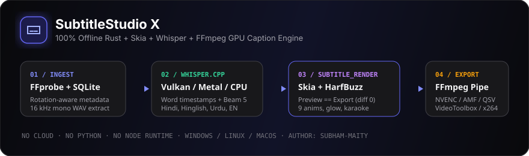
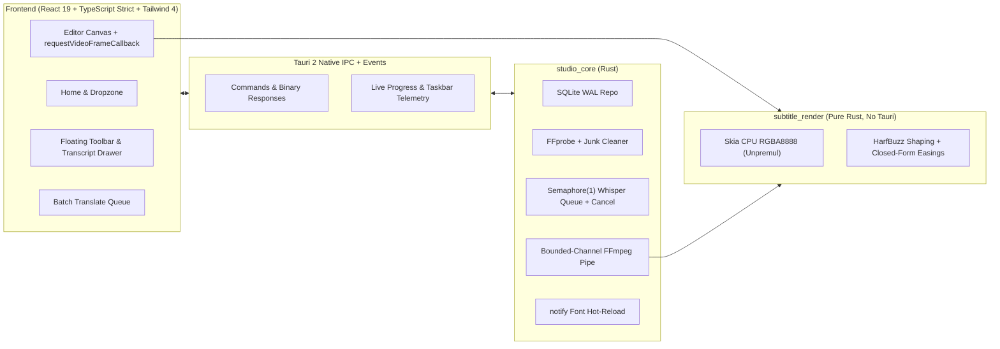

<div align="center">



<br/>

# SubtitleStudio X

### Offline, GPU-accelerated animated subtitle & transcription studio — built natively in Rust.

**SubtitleStudio X** is the next-generation native desktop successor to [**SubtitleStudio**](https://github.com/Subham-Maity/SubtitleStudio) *(Free & open-source local AI subtitle burner — no cloud, no API key, no subscription)*.<br/>
No Python server. No Node backend. No Redis. No Docker. Just **Rust + Skia + whisper.cpp + FFmpeg** in a single desktop application.

[](https://github.com/Subham-Maity/SubtitleStudio-X/releases)
[](https://github.com/Subham-Maity/SubtitleStudio-X/actions)
[](LICENSE)


[**Download**](https://github.com/Subham-Maity/SubtitleStudio-X/releases) ·
[**Successor Architecture**](#from-subtitlestudio-v1-to-subtitlestudio-x) ·
[**Features**](#features-and-rendering-engine) ·
[**Quick Start**](#installation) ·
[**Build & CI**](#building-from-source)

<br/>

**Created by [ Subham-Maity](https://github.com/Subham-Maity) · [Original SubtitleStudio (v1)](https://github.com/Subham-Maity/SubtitleStudio) · [Instagram](https://www.instagram.com/subham_xam/)**

</div>

---

## From SubtitleStudio (v1) to SubtitleStudio X

The original [SubtitleStudio](https://github.com/Subham-Maity/SubtitleStudio) proved you can transcribe, style, and burn animated captions locally without cloud APIs — using Next.js, NestJS, Redis, PostgreSQL, Python (`faster-whisper`), and `.ass`/Canvas rendering.

**SubtitleStudio X** replaces the entire multi-runtime stack with one pure-Rust core:

| Layer | Original SubtitleStudio (v1) | SubtitleStudio X (Rust Rewrite) |
|---|---|---|
| **Runtime** | Node.js + NestJS + Next.js + Python FastAPI + Redis + Postgres | **Single native Rust + Tauri 2 binary** + bundled SQLite (`WAL`) |
| **Speech AI** | External Python service (`faster-whisper`) | **Embedded `whisper-rs` (`whisper.cpp`)** on Vulkan / Metal / CPU |
| **Subtitle Renderer** | Separate Web Canvas preview + ASS/FFmpeg export renderer | **One shared `subtitle_render` Skia + HarfBuzz engine (`diff == 0` parity)** |
| **Multilingual Shaping** | Browser text metrics vs libass discrepancies | **Unified HarfBuzz shaping** across English, Devanagari, Urdu/RTL & Emoji |
| **Video Pipeline** | Multi-step intermediate renders & browser blob uploads | **Bounded-channel RGBA pipe** directly to hardware FFmpeg (`nvenc`/`amf`/`qsv`/`videotoolbox`) |
| **GPU Fallback** | Manual CUDA/Python environment setup | **Automatic zero-crash fallback**: delay-loaded Vulkan + CPU Whisper + CPU `libx264` |

---

##  At a Glance

| | |
|---|---|
|  **Zero Cloud, Zero API Keys** | All speech recognition, styling, previewing, and hardware video encoding execute 100% locally on your hardware. |
|  **Pixel-Identical Preview & Export** | Live `<canvas>` preview and final video export call the exact same pure `subtitle_render::render_frame` function (`diff == 0` verified). |
|  **Works on Every GPU (or No GPU)** | Accelerates Whisper with Vulkan (Windows/Linux) or Metal (macOS) and FFmpeg with NVENC, AMF, QSV, or VideoToolbox — cleanly falling back to CPU when absent. |
|  **Multilingual Precision** | Custom HarfBuzz shaping renders English, Hindi (Devanagari & Roman Hinglish), Urdu/RTL, and color emoji identically on canvas and disk. |
|  **Creator-Grade Typography** | 9 entrance animations, 2 exits, 3 index-accurate karaoke modes, clip/mask strokes, neon glow, gradients, rotation, and live font hot-reload. |
|  **Batch Folder & Merge Engine** | Auto-detect spoken language per clip, translate non-English tracks to English, resume cleanly via `index.json`, and merge timelines to master `.txt`/`.srt`. |

---

##  Architecture



### Workspace Crates

| Crate | Purpose |
|---|---|
| [`crates/subtitle_render`](crates/subtitle_render/Cargo.toml) | Pure deterministic `render_frame(timeline, t_ms, w, h) -> RGBA` library with zero Tauri dependency, HarfBuzz `textlayout`, WYSIWYG `540p` scale math, frame-cache deduplication, and golden-image tests. |
| [`crates/studio_core`](crates/studio_core/Cargo.toml) | Domain engine: SQLite migrations, FFprobe metadata/rotation handling, Whisper GGML manager & inference engine, Tokio queue with `CancellationToken`, cue generation & SRT/TXT merge, batch processor, and FFmpeg export pipeline. |
| [`src-tauri`](src-tauri/Cargo.toml) | Native desktop shell: Tauri 2 commands, live event emitters, WebView2/asset font serving, Windows taskbar export progress, and multi-OS bundler configuration. |

---

##  Features and Rendering Engine

### WYSIWYG Deterministic Rendering
- **Reference Scaling (`540.0`):** Every font size, outline thickness, shadow offset, blur radius, padding, and `%` canvas coordinate scales linearly with `out_h / 540.0` so preview matches 1080p/4K export.
- **Unpremultiplied RGBA Output:** Skia reads pixels as `AlphaType::Unpremul` + `ColorType::RGBA8888`, eliminating dark fringe halos when FFmpeg overlays captions over video frames.
- **Zero-Allocation Frame Cache:** Transparent frames reuse a single preallocated buffer, and static non-animating frames return cached pixels directly without re-rasterizing.

### Animations, Karaoke & Styling
- **Entrance Animations (9):** `none`, `fade`, `pop` (1.2x overshoot), `slide-up`, `zoom`, `typewriter`, `word-reveal`, `bounce`, `blur-in`.
- **Exit Animations (2):** `fade-out`, `slide-down`.
- **Closed-Form Easings:** `linear`, `cubic`, `back`, `elastic`, `spring`.
- **Index-Accurate Karaoke:** Highlighting uses exact `[wordStartIdx, wordEndIdx)` + token timing (`highlight-current-word`, `progressive-fill`, `pop-current`) so repeated words never highlight incorrectly.
- **Effects & Strokes:** Clip/mask strokes (`inside`, `outside`, `center`), drop shadow, Gaussian neon glow, angled linear gradient text fills, rounded background boxes, canvas drag/rotate/resize handles, per-cue color overrides, uppercase mode, 5 built-in presets (`minimal`, `karaoke`, `outline`, `box`, `neon`), and custom JSON preset save/load.

### Cue Generation & Language Modes
- **Exact Cue Rules:** Breaks lines at `words_per_cue` (default `6`) or pauses `> 700 ms`, appends `150 ms` tail padding, clamps overlaps cleanly (`max(start + 100, nextStart - 20)`), and proportionally redistributes token timings when cues are manually edited.
- **Whisper Language Modes:** `auto`, `en` (translate any language to English), `hi-strict` (Devanagari prompt), `hi`, `hi-roman` (Hinglish Roman script prompt), `ur`, `es`, `fr` — running with `BeamSearch(5)`, `no_context`, and per-token timestamps.

### Export Modes & Encoder Priority
- **Overlay Mode:** Streams straight-alpha frames into FFmpeg (`[0:v]fps=...,format=yuv420p[bg];[bg][1:v]overlay=...`) normalizing VFR inputs cleanly with `-c:a copy` (or AAC 192k when container requires).
- **Captions-Only Mode:** Renders captions onto a solid black, white, or custom hex background via FFmpeg `lavfi` with optional original audio.
- **Hardware Auto-Detection (1-Frame Probe):**
  - **Windows & Linux:** `h264_nvenc` → `h264_amf` → `h264_qsv` → `libx264` (`hevc_*` + `-tag:v hvc1` for MOV).
  - **macOS:** `h264_videotoolbox` → `libx264` (`hevc_videotoolbox` → `libx265` for MOV).
  - Transparently displays the active encoder badge and warns if CPU fallback is used.

---

##  Installation

Download prebuilt binaries from the [Releases page](https://github.com/Subham-Maity/SubtitleStudio-X/releases). Every release includes `SHA256SUMS.txt`.

| Platform | Recommended Asset | Portable / Alternative | Notes |
|---|---|---|---|
| **Windows 10 / 11 (x64)** | `SubtitleStudioX-windows-x64-setup.exe` | `.msi` / `SubtitleStudioX-windows-x64-portable.zip` | Bundles FFmpeg `n8.1`, FFprobe, fonts, and WebView2 bootstrapper. |
| **Linux (x86_64)** | `SubtitleStudioX_<ver>_amd64.deb` | `.AppImage` / `SubtitleStudioX-linux-x86_64.tar.gz` | Vulkan GPU Whisper + NVENC/AMF/QSV/CPU encoding. |
| **macOS (Apple Silicon)** | `SubtitleStudioX-macos-aarch64.dmg` | `SubtitleStudioX-macos-aarch64.app.tar.gz` | Apple Metal Whisper + VideoToolbox hardware export. |
| **macOS (Intel)** | `SubtitleStudioX-macos-x86_64.dmg` | `SubtitleStudioX-macos-x86_64.app.tar.gz` | Apple Metal / CPU + VideoToolbox hardware export. |

> **First Run Whisper Models:** AI weights are downloaded on demand inside **AI Models** (`base` ~142 MB, `small` ~466 MB, `large-v3-turbo-q5_0` ~547 MB, `large-v3-turbo` ~1.5 GB) so installers stay compact.

---

##  Project Structure

```
.
├── assets/                     hero banner & README SVG icons
├── crates/
│   ├── subtitle_render/        deterministic Skia + HarfBuzz subtitle renderer crate
│   │   └── tests/              golden-image & preview-export parity tests
│   └── studio_core/            SQLite repo, Whisper engine, queue, cues, batch & export
│       ├── examples/           60s 1080p30 export benchmark
│       └── tests/              end-to-end pipeline integration suite
├── scripts/                    dev launcher, FFmpeg & model fetchers, Windows release script
├── src/                        Vite + React 19 + TypeScript strict + Tailwind 4 frontend
├── src-tauri/                  Tauri 2 host app, IPC commands, capabilities & icons
├── .github/workflows/          ci.yml (3-OS checks) & release.yml (4-target builds)
├── CHANGELOG.md                structured per-version release history
├── LICENSE                     MIT License
└── README.md
```

---

##  Building from Source

### Prerequisites
- **All platforms:** Rust (`stable`), Node.js 22+, CMake, Ninja, LLVM/Clang (`libclang` for Skia/Whisper bindings).
- **Windows:** Visual Studio Build Tools (Desktop C++), [Vulkan SDK](https://vulkan.lunarg.com/), NSIS 3.13 (for `.exe` installer).
- **Linux (Debian/Ubuntu):**
  ```bash
  sudo apt-get update && sudo apt-get install -y \
    libwebkit2gtk-4.1-dev libgtk-3-dev libayatana-appindicator3-dev \
    librsvg2-dev patchelf clang libclang-dev cmake ninja-build libvulkan-dev
  ```
- **macOS:** Xcode Command Line Tools + `brew install cmake ninja`.

### Build Commands

**Windows PowerShell:**
```powershell
npm ci
.\scripts\fetch-ffmpeg.ps1
.\scripts\build.ps1          # runs typecheck, vite build, clippy, workspace tests, and tauri bundle
```

**Linux / macOS:**
```bash
npm ci
# Place platform ffmpeg & ffprobe binaries in src-tauri/binaries/ with Rust target triple suffix
# (e.g. ffmpeg-x86_64-unknown-linux-gnu or ffmpeg-aarch64-apple-darwin)
npm run build
cargo clippy --workspace --all-targets -- -D warnings
cargo test --workspace
npx @tauri-apps/cli build
```

---

##  CI and Automated Releases

- **Continuous Integration ([`.github/workflows/ci.yml`](.github/workflows/ci.yml)):** Runs strict frontend `tsc --noEmit` + Vite build plus Rust `cargo clippy --all-targets -- -D warnings` and `cargo test --workspace` on every push and pull request across **Windows**, **Linux**, and **macOS**.
- **Automated Releases ([`.github/workflows/release.yml`](.github/workflows/release.yml)):** Triggered by pushing a version tag (`git tag v0.1.0 && git push origin v0.1.0`) or manually via **workflow_dispatch**. Builds Windows NSIS/MSI/Portable, Linux `.deb`/`.AppImage`/`.tar.gz`, and macOS `arm64`/`x86_64` `.dmg`/`.app.tar.gz`, computes `SHA256SUMS.txt`, extracts release highlights from [`CHANGELOG.md`](CHANGELOG.md), and publishes a GitHub Release automatically.

---

##  Troubleshooting

- **Windows SmartScreen / Defender Warning:** Open-source binaries are built publicly on GitHub Actions without a commercial EV code-signing certificate. Click **More info → Run anyway** on first launch.
- **macOS Gatekeeper Block:** Right-click **Open**, use **System Settings → Privacy & Security → Open Anyway**, or run `xattr -cr "/Applications/SubtitleStudio X.app"`.
- **Hardware Export Falls Back to CPU:** Verify your GPU driver is up to date (for NVIDIA Pascal/GTX 10-series drivers such as `581.57`, ensure you are using the bundled FFmpeg `n8.1` sidecar rather than an external outdated/incompatible FFmpeg in `PATH`).

---

##  Author & Contributing

Built and maintained by **Subham Maity**:
- **GitHub:** [github.com/Subham-Maity](https://github.com/Subham-Maity)
- **Instagram:** [@subham_xam](https://www.instagram.com/subham_xam/)
- **Predecessor:** [Subham-Maity/SubtitleStudio](https://github.com/Subham-Maity/SubtitleStudio)

Contributions, bug reports, and pull requests are welcome.

---

##  License

Released under the [MIT License](LICENSE).

